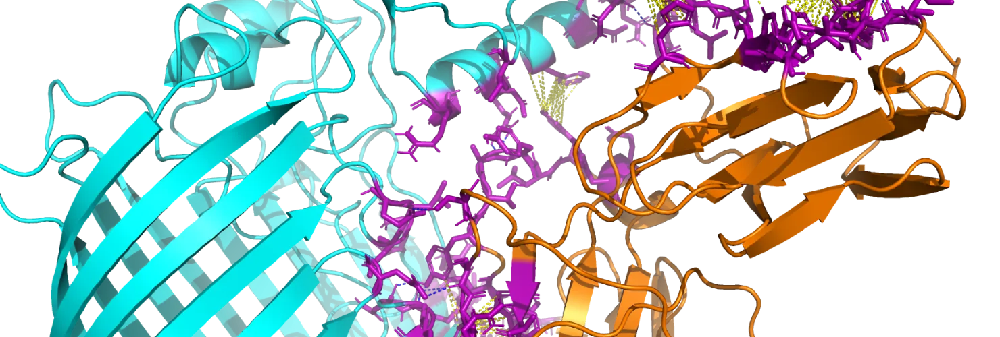
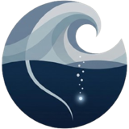
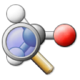
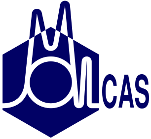
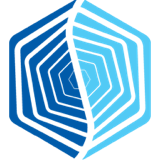
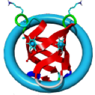
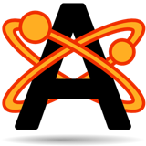

<h1 align="center">Nimasha Thejani Ganegoda Gei</h1>

 Dubai, UAE

  
  
  
  
  

---

### Trading research

Systematic long/short research on gold and bitcoin, written up as I go in [quant-notes](https://teejay772.github.io/quant-notes/).

| Question | Note |
|:--|:--|
| Which way? | [Time-series momentum](https://teejay772.github.io/quant-notes/momentum.html) |
| How big? | [Volatility by EWMA](https://teejay772.github.io/quant-notes/ewma.html) |
| Can I trust the backtest? | [Errors and controls](https://teejay772.github.io/quant-notes/backtest.html) · [Backtester](https://teejay772.github.io/quant-notes/backtester.html) |
| Is the Sharpe ratio real? | [Sharpe ratio estimation](https://teejay772.github.io/quant-notes/sharpe.html) |

[Research plan and weekly status](https://teejay772.github.io/quant-notes/roadmap.html)

### Quantum chemistry

- [A non-De Mayo photochemical pathway](https://teejay772.github.io/Computational-Elucidation-of-the-Non-De-Mayo-Photochemical-Pathway/) (slides)
- [Z/E isomerisation of ketone-based hydrazones](https://teejay772.github.io/Ketone-based-hydrazones/) (slides)

### Writing

&nbsp; [The Abyss](https://theabyssos.com), a science journal for everyone, where I write evidence-led articles.

### Toolkit

  &nbsp;
  &nbsp;
  <picture><source media="(prefers-color-scheme: dark)" srcset="assets/logos/pandas-white.svg"></picture>&nbsp;
  &nbsp;
  &nbsp;
  &nbsp;
  &nbsp;
  &nbsp;
  <picture><source media="(prefers-color-scheme: dark)" srcset="assets/logos/bash-white.svg"></picture>&nbsp;
  &nbsp;
  

  &nbsp;
  &nbsp;
  <picture><source media="(prefers-color-scheme: dark)" srcset="assets/logos/molcas-white.png"></picture>&nbsp;
  &nbsp;
  &nbsp;
  &nbsp;
  &nbsp;
  &nbsp;
  <picture><source media="(prefers-color-scheme: dark)" srcset="assets/logos/avogadro-white.png"></picture>&nbsp;
  &nbsp;
  <picture><source media="(prefers-color-scheme: dark)" srcset="assets/logos/slurm-white.svg"></picture>

**Also:** ORCA · CREST · PyRAI2MD
